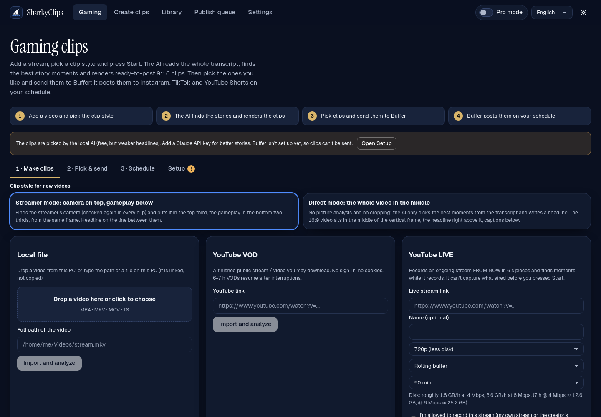
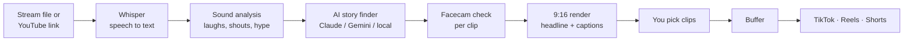
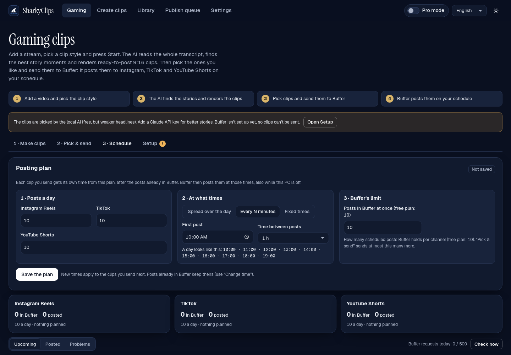
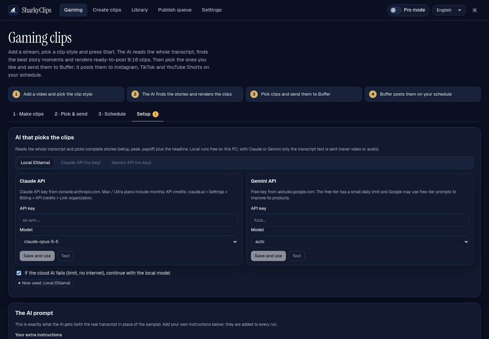

<p align="center">
  <picture>
    <source media="(prefers-color-scheme: dark)" srcset="assets/icon/sharkyclips.png">
    
  </picture>
</p>

<h1 align="center">Viral Gaming Clip Creator</h1>

<p align="center">
  <b>Drop in a 1 to 10 hour stream and get ready-to-post vertical clips.</b><br>
  An AI reads the whole stream, finds every moment worth a clip, cuts each one from setup to payoff,
  puts the streamer's facecam on top and adds a viral headline. Then it sends your picks to Buffer,
  which posts them to <b>TikTok</b>, <b>Instagram Reels</b> and <b>YouTube Shorts</b> on your schedule.
</p>

<p align="center">
  
  <a href="LICENSE"></a>
  
  
  
  
</p>

<p align="center">
  <a href="#quick-start"><b>Quick start</b></a> ·
  <a href="#how-it-works">How it works</a> ·
  <a href="#what-this-fork-adds">What this fork adds</a> ·
  <a href="#daily-routine-10-posts-a-day">Daily routine</a> ·
  <a href="#costs-and-speed">Costs</a> ·
  <a href="#credits">Credits</a> ·
  <a href="#türkçe">Türkçe</a>
</p>

<picture>
  <source media="(prefers-color-scheme: light)" srcset="docs/screenshots/gaming-make-light.png">
  
</picture>

---

## Why

Clipping long streams by hand takes hours. Generic AI clippers often miss the streamer's camera, let
the audio drift out of sync, or cut a joke before its punchline. This app is built for gaming
streams only:

- 🎯 **Complete stories, not random seconds.** Every clip runs from the setup to the payoff, so
  someone who never saw the stream still gets it.
- 🎥 **Facecam on top, gameplay below, from the same frame.** The streamer's camera is found by face
  detection and checked again inside every clip, so lip sync stays perfect.
- 📝 **Captions that read like the big clip pages.** For example *"Speed was FURIOUS when he found
  tigers locked in cages in GTA 6 😡🐯"*: third person, names the streamer, one word in caps, 1–2
  emojis. The caption is shown as an Instagram-style white box on the clip.
- 📈 **As many clips as the stream gives.** The AI lists every story that works on its own (up to
  about 30 per hour of a lively stream) and drops what it rates as boring.
- 🗓️ **Posting without babysitting.** You pick clips, Buffer posts them at their times, and your PC
  can be off.

## How it works



1. **Add a video** on the Gaming page: drag and drop a file, paste a YouTube VOD link, or record a
   YouTube live stream. Then pick a clip style:
   - **Streamer mode:** the facecam is cut out into the top third and the gameplay fills the bottom two thirds.
   - **Direct mode:** the whole 16:9 video sits in the middle with the headline above it. No picture analysis.
2. **The AI does the rest:**
   - Whisper transcribes the stream.
   - Sound analysis tags the laughs, shouts and loud peaks.
   - The story finder reads the whole numbered transcript with those tags and returns, for each
     story, its start, peak and end line, a score and a viral headline.
   - The clips render by themselves, with captions and the headline box.
3. **Pick & send:** watch the clips, edit a title if you like, tick the ones you want and press
   **Send to Buffer**. Each post gets its own time from your posting plan.
4. **Buffer posts them** to TikTok, Instagram Reels and YouTube Shorts at those times, even while
   your PC is off.

### How long is a clip?

The AI marks a story's **start** (where a stranger can start following), its **peak** (the funniest
or most intense moment) and its **end** (the reaction is over and the sentence is finished).

- Length rules (adjustable): **30–120 s, aiming for about 55 s**, the length that performs best on Reels.
- Only stories scored 85 or more may run to the maximum. The others stay under about 90 s.
- A story that is too long is trimmed from its start first (never past the setup right before the
  peak), then from its end.
- A story that is too short gets more setup first, then more payoff.

<picture>
  <source media="(prefers-color-scheme: light)" srcset="docs/screenshots/gaming-plan-light.png">
  
</picture>

## Quick start

> Tested on Linux (Ubuntu / Debian based) with an NVIDIA GPU. The Windows and macOS one-click
> installers come from SharkyClips and now install this repository. A GPU is strongly recommended;
> without one, transcription and rendering are much slower.

**You need:** Python 3.11–3.13, FFmpeg, Git and about 15 GB of free disk space. For YouTube links
you also need Deno or Node.js. Ollama is optional; it is only used for the local AI.

### Linux / macOS (manual)

```bash
git clone https://github.com/ierenkucukali/viral-gaming-clip-creator.git
cd viral-gaming-clip-creator
python3 -m venv .venv
source .venv/bin/activate
python -m pip install -r backend/requirements.txt
python -m pip install -r backend/requirements-nvidia.txt   # NVIDIA GPU only
cd backend
python cli.py doctor --download-models   # checks FFmpeg/GPU, downloads the Whisper (+ local AI) models
python cli.py serve                      # opens http://127.0.0.1:8000
```

Next time, start it with `./scripts/start.sh` from the repository folder. That script keeps the
settings in `./.sharkyclips` and serves on `127.0.0.1:8000`.

### Windows 10 / 11

Clone the repository (or download the ZIP) and double-click **`install.bat`**. It shows what it will
install (Python, FFmpeg, Git, Deno, Ollama, the packages and the models), asks once, and creates a
desktop shortcut. Alternatively, follow the manual steps above in PowerShell, using
`.venv\Scripts\activate`.

### macOS (one command)

```bash
bash install.sh
```

### First-time setup in the app (about 10 minutes, once)

Open **Gaming → Setup**:

| What | Where to get it | Why |
|---|---|---|
| **Claude API key** (recommended) | [console.anthropic.com](https://console.anthropic.com) → API keys | The best stories and headlines. If it fails, the local AI takes over |
| or **Gemini API key** | [aistudio.google.com](https://aistudio.google.com) → Get API key | Free tier available |
| or nothing | — | The local Ollama model (free, weaker headlines) |
| **Buffer API key** | [buffer.com](https://buffer.com) (free plan) → connect TikTok, Instagram (Business/Creator) and YouTube → [Settings → API](https://publish.buffer.com/settings/api) | Posts your clips |
| **Cloudinary** cloud name, API key and secret | [cloudinary.com](https://cloudinary.com) (free, no card) → Dashboard, then Settings → API Keys | Buffer fetches every video from a public link; each copy is deleted after it was posted |

Press **Save and test**. Green ticks mean you are ready. Then open the **Schedule** tab, set your
posting plan and press **Save the plan**.

All keys are stored **encrypted on your PC** and are never shown again. Only the transcript text
goes to Claude or Gemini, never the video or the audio.

<picture>
  <source media="(prefers-color-scheme: light)" srcset="docs/screenshots/gaming-setup-light.png">
  
</picture>

## Daily routine: 10 posts a day

1. **Make clips:** add the stream, choose the style and press Start. A 1-hour video takes about 20
   minutes on a 6 GB laptop GPU and gives up to about 20 clips.
2. **Pick & send:** the page shows **"Room in Buffer now: 10"**. Buffer's free plan holds 10
   scheduled posts per channel. Tick 10 clips and press **Send to Buffer**. Sent clips are marked and
   can never go out twice.
3. **Close the app.** Buffer posts them at the planned times, for example 10:00, 11:00, … 19:00.
4. **Tomorrow:** open the app and send the next 10. New posts continue after the ones already in Buffer.

Nothing runs in the background and nothing waits on your PC, so a closed app never causes errors.
Opening the **Schedule** tab checks what was posted while the app was closed and cleans up the
hosted copies. On Buffer's paid plan the 10-post limit goes away: raise "Buffer's limit" and send a
whole week at once.

**Posting plan options:**
- posts per day, set per platform;
- times spread between a first and a last post, one post every N minutes (15 min to 4 h) from a
  start time, or fixed times;
- start from a date;
- **Change time** on a single post, which updates it in Buffer too.

## What this fork adds

This project is a fork of **[SharkyClips](https://github.com/utkualsir/sharkyclips)** by
[@utkualsir](https://github.com/utkualsir) (MIT). SharkyClips already provides the local
transcription, highlight signals, 9:16 rendering, captions, swear bleeping and the web UI. This fork
turns it into a focused **gaming-stream clipper**:

| Area | Added in this fork |
|---|---|
| 🧠 **AI story finder** | Reads the whole transcript (long streams in 1-hour parts) and returns complete stories with a start, peak and end line, a score, a viral headline, a title and a "why". The clip count is automatic, and the prompt is visible and extendable in the app |
| ☁️ **Cloud or local AI** | Claude (Opus / Sonnet / Haiku 5.5) through the official `anthropic` SDK, Gemini through REST, or local Ollama, with automatic fallback to the local model when the cloud fails |
| 🎥 **Two clip styles** | *Streamer*: facecam cut into the top third and gameplay below, from the same frame, with the facecam checked again per clip. *Direct*: the whole 16:9 video centred with no picture analysis |
| 🏷️ **Viral headline box** | Instagram-style white box with black text and colour emoji, up to 3 lines, placed at the seam (streamer style) or above the video (direct style), with a matching live preview |
| ⚙️ **One-page workflow** | Gaming page with four tabs (Make clips → Pick & send → Schedule → Setup), drag-and-drop upload, clips that render by themselves, and a per-PC time estimate for 30 min to 10 h videos |
| 📤 **Buffer publishing** | Send-now to Buffer with the room per channel read from Buffer, a posting plan, change time, cancel, send again, and sent clips marked. Cloudinary hosting with automatic clean-up. Every API call is checked against Buffer's real GraphQL schema in the tests |
| 🔴 **YouTube live recorder** | Records an ongoing stream in segments and finds moments while it records |
| 🧪 **Tests** | Story finder, headline rendering (pixel checks), Buffer (fake Buffer + Cloudinary, schema validation) and the clip styles |

The full list is in [CHANGELOG.md](CHANGELOG.md) (1.2.53 – 1.2.55). The cost and quality notes are
in [docs/AI_COSTS.md](docs/AI_COSTS.md), and the Buffer setup is in
[docs/PUBLISHING_SETUP.md](docs/PUBLISHING_SETUP.md). The original SharkyClips documentation,
covering every inherited feature, is kept in [docs/SHARKYCLIPS_README.md](docs/SHARKYCLIPS_README.md).

## Costs and speed

**AI cost for a 1-hour stream** (estimates from measured transcript sizes; your numbers depend on
how much the streamer talks):

| AI | About |
|---|---|
| Claude Opus 5.5 | $0.25 |
| Claude Sonnet 5.5 | $0.12 |
| Claude Haiku 5.5 / Gemini Flash | a few cents |
| Local Ollama | free (uses your GPU) |

**Other services:** Buffer free plan (3 channels, 10 scheduled posts each) and Cloudinary free plan.
Total: $0 plus the AI.

**Time on a 6 GB laptop GPU** (shown live in the app and refined from your own runs):

| Video | Clips | With Claude | With local AI |
|---|---|---|---|
| 1 h | ~20 | ~18 min | ~25 min |
| 10 h | ~200 | ~3 h (mostly rendering) | ~4 h |

## Privacy and fair use

- The app runs on your PC and is served only on `127.0.0.1`.
- Video and audio never leave the PC, except the clips you send to Buffer, which go through your
  own Cloudinary account.
- API keys are stored encrypted and never logged.
- Only clip streams you own or have permission to use. The app does not bypass DRM, sign-ins,
  paywalls, CAPTCHAs or rate limits.
- Follow the rules of Buffer, TikTok, Instagram and YouTube.

## Development

```bash
source scripts/env.sh                        # local .venv + settings in ./.sharkyclips
python -m pytest -q                          # backend tests
python -m ruff check backend                 # lint
cd frontend && npm ci && npm run build       # UI (React + Vite); the built frontend/dist is committed
node scripts/check-i18n.mjs                  # every UI string in all 7 languages
```

Backend: Python 3.11+, FastAPI, faster-whisper, FFmpeg, OpenCV face detection, Pillow.
Frontend: React + Vite + TypeScript.

## Credits

- **[SharkyClips](https://github.com/utkualsir/sharkyclips)** by [@utkualsir](https://github.com/utkualsir)
  (MIT). This repository is built on it, and all inherited features and most of the engine are theirs. Thank you!
- [faster-whisper](https://github.com/SYSTRAN/faster-whisper), [FFmpeg](https://ffmpeg.org),
  [yt-dlp](https://github.com/yt-dlp/yt-dlp), [Ollama](https://ollama.com), [FastAPI](https://fastapi.tiangolo.com),
  [React](https://react.dev), [Anthropic Claude](https://www.anthropic.com),
  [Google Gemini](https://ai.google.dev), [Buffer](https://buffer.com), [Cloudinary](https://cloudinary.com).

## License

[MIT](LICENSE). The original copyright notice of SharkyClips is kept in [LICENSE](LICENSE).

---

## Türkçe

**Viral Gaming Clip Creator**, uzun yayınları (1–10 saat) otomatik olarak dikey, paylaşıma hazır
kliplere çeviren, bilgisayarında çalışan bir uygulamadır. [SharkyClips](https://github.com/utkualsir/sharkyclips)
(MIT) temel alınarak geliştirildi.

- **Yapay zekâ tüm transkripti okur.** Tek başına klip olabilecek her hikâyeyi bulur: başlangıç,
  zirve ve tepki. Saatte en fazla yaklaşık 30 klip çıkarır. Claude, Gemini ya da ücretsiz yerel model
  kullanılabilir; bulut çalışmazsa yerel model devralır.
- **Yayıncı modu:** yüz kamerası üst üçte birde, oyun altta; ikisi aynı kareden alındığı için dudak
  senkronu bozulmaz. **Direkt mod:** 16:9 video ortada, başlık üstünde.
- **Viral başlık kutusu:** Instagram tarzı beyaz kutu, örneğin *"Speed was FURIOUS when he found
  tigers locked in cages in GTA 6 😡🐯"*.
- **Buffer ile paylaşım:** klipleri seçip **Send to Buffer**'a basarsın. Her gönderi plandaki saatini
  alır ve Buffer, bilgisayar kapalıyken TikTok, Reels ve Shorts'a paylaşır. Ücretsiz planda kanal
  başına 10 planlı gönderi olur: günde bir kez uygulamayı açıp yeni 10 klibi gönderirsin.

**Kurulum:** yukarıdaki [Quick start](#quick-start) adımları. Ardından **Gaming → Setup**'a Claude
(ya da Gemini), Buffer ve Cloudinary anahtarlarını girip **Save and test**'e bas.
